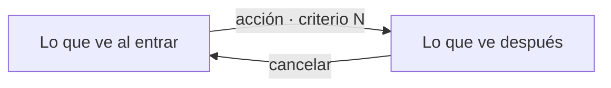

# NNN — Flujo de interacción

Spec: `specs/NNN-descripcion/spec.md`

Se escribe antes que el plan y va en el mismo PR. Sale de los criterios
de la spec y define cómo se recorre la interacción antes de hacer la UI.
Si algo no cierra, se corrige la spec en su propio PR.

## Recorrido

Camino principal y alternativos: cancelar, vacío y error. Cada caja es lo
que la persona ve; cada flecha, lo que hace. Citar el número de criterio.

## Componentes de Bootstrap

La UI usa Bootstrap 5.3 (`src/shared/ui/bootstrap/`). No se inventan
componentes: si un paso pide algo que Bootstrap no hace, se ajusta la spec
a lo que Bootstrap ofrece o se justifica acá el componente propio.

| Paso del recorrido | Componente de Bootstrap (link a su doc) | ¿Cubre lo que pide la spec? |
|---|---|---|
| … | … | sí · no: qué falta y qué se decide |

## Heurísticas de Nielsen

Una línea por heurística: "ok" o el hallazgo y qué se decide.

1. Visibilidad del estado del sistema: …
2. Coincidencia con el mundo real: …
3. Control y libertad (deshacer, cancelar): …
4. Consistencia y estándares: …
5. Prevención de errores: …
6. Reconocer antes que recordar: …
7. Flexibilidad y eficiencia: …
8. Diseño estético y minimalista: …
9. Ayuda para reconocer y recuperarse de errores: …
10. Ayuda y documentación: …
