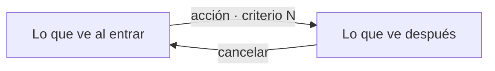

# NNN — Flujo de interacción

Spec: `specs/NNN-descripcion/spec.md`

Se escribe antes que el plan y va en el mismo PR. Sale de los criterios
de la spec y define cómo se recorre la interacción antes de hacer la UI.
Si algo no cierra, se corrige la spec en su propio PR.

## Recorrido

Camino principal y alternativos: cancelar, vacío y error. Cada caja es lo
que la persona ve; cada flecha, lo que hace. Citar el número de criterio.



## Componentes de Bootstrap

Cada paso elige su componente de `docs/sdd/bootstrap.md`, que dice qué
trae Bootstrap 5.3 y qué agrega Nivva. No se inventan componentes: si un
paso pide algo que Bootstrap no hace, se ajusta la spec a lo que Bootstrap
ofrece o se justifica acá el componente propio.

| Paso del recorrido | Componente de Bootstrap (link a su doc) | ¿Cubre lo que pide la spec? |
|---|---|---|
| … | … | sí · no: qué falta y qué se decide |

## Wireframe

Cada pantalla o estado que cambia, en texto a 320 px de ancho. Solo
elementos, orden y textos de la spec, con el componente de Bootstrap a la
derecha. Sin colores ni medidas: alcanza con ver qué entra y qué se ve.

```
Notación: [Botón]  (◯─) interruptor  [__] campo  [▾] desplegable
          ⋮ menú  ── separador  «texto» texto exacto de la spec

┌──────────────────────────────────┐  320 px
│ «Título de la pantalla»          │
│ …un elemento por línea, en el    │  componente de Bootstrap
│   orden en que se ve…            │  de cada elemento
└──────────────────────────────────┘
```

## Heurísticas de Nielsen

Se evalúan sobre el recorrido y el wireframe. Una línea por heurística:
respuesta corta y, si hay un hallazgo, qué se decide.

1. ¿Después de cada acción, la persona ve o escucha qué pasó?
2. ¿Las palabras son las de la persona y del glosario, no las del sistema?
3. ¿Puede cancelar o volver atrás sin perder lo que hizo?
4. ¿Se ve y se usa igual que en el resto de Nivva y que en Bootstrap?
5. ¿Qué error es fácil cometer acá y cómo se evita?
6. ¿Tiene a la vista lo que necesita, sin recordarlo de otra pantalla?
7. ¿Lo frecuente se hace en pocos pasos?
8. ¿Sobra algo en la pantalla que no ayude a la tarea?
9. ¿Los errores dicen qué pasó y cómo seguir?
10. ¿Hace falta alguna ayuda o texto de apoyo?
