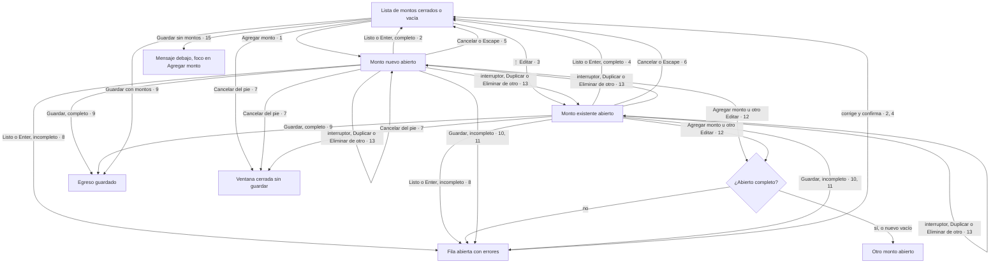

# 002 — Flujo de interacción

Spec: `specs/002-agregar-editar-monto-en-lista/spec.md`

## Recorrido



## Componentes de Bootstrap

| Paso del recorrido | Componente de Bootstrap | ¿Cubre lo que pide la spec? |
|---|---|---|
| Ventana del egreso | [Modal](https://getbootstrap.com/docs/5.3/components/modal/), ya en uso | Sí. Su `Escape` no tiene que cerrar la ventana si el foco está en la fila abierta (criterios 5 y 6): lo decide la fila |
| Lista y fila cerrada | Lista de la spec 001, sin cambios | Sí |
| Campos del monto abierto | [Campo](https://getbootstrap.com/docs/5.3/forms/form-control/) y [select](https://getbootstrap.com/docs/5.3/forms/select/), ya en uso | Sí |
| Errores | [Validación](https://getbootstrap.com/docs/5.3/forms/validation/) | Solo color y texto. Nivva marca el campo y lo asocia a su mensaje |
| "Listo", "Cancelar" y pie | [Botones](https://getbootstrap.com/docs/5.3/components/buttons/) | Sí |
| Anuncios | `visually-hidden`, región de la spec 001 | Sí |

## Wireframe

```
Notación: [Botón]  (◯─) interruptor  [__] campo  [▾] desplegable
          ⋮ menú  ── separador  «texto» texto exacto de la spec

┌──────────────────────────────────┐  320 px
│ «Editar egreso»                  │  Modal
│ Acreedor [__]  Tipo de deuda [__]│  Campos, sin cambios
│ Montos *                         │
│ ┌ $ 15.000 · Vence el 10/11 ──── │  Lista (spec 001)
│ │                       (◯─)  ⋮  │
│ ├ monto abierto ──────────────── │  Fila con borde
│ │ Monto [__]                     │  Campo
│ │ «Ingresá un monto válido.»     │  Validación
│ │ Moneda [▾]                     │  Select
│ │ Vencimiento [__]               │  Campo
│ │ «Completá monto, moneda y      │  Validación
│ │  vencimiento para agregar el   │
│ │  monto.»                       │
│ │              [Cancelar] [Listo]│  Botones
│ └─────────────────────────────── │
│                  [Agregar monto] │  Botón secundario
│ Notas [__]                       │  Campo, sin cambios
│ ──────────────────────────────── │
│             [Cancelar] [Guardar] │  Con borde · Relleno
└──────────────────────────────────┘
```

## Heurísticas de Nielsen

1. Sí: la fila cambia a la vista y el lector anuncia agregar y actualizar.
2. Sí: "monto" y "vencimiento", del glosario; "Listo" es la excepción de `06-CTAs.md`.
3. Sí: "Cancelar" y `Escape` devuelven la fila a como estaba.
4. Sí: mismos campos y botones de Bootstrap que el resto de la ventana.
5. Perder un monto escrito al tocar "Guardar": se evita con los criterios 9 a 11.
6. Sí: la lista sigue visible mientras se escribe.
7. Sí: `Enter` confirma y el foco queda en el ⋮ o en "Agregar monto".
8. Sí: desaparecen el título y el segundo "Guardar" del formulario aparte.
9. Sí: cada campo dice qué falta y el foco va al primero.
10. No hace falta: los nombres de los campos alcanzan.
