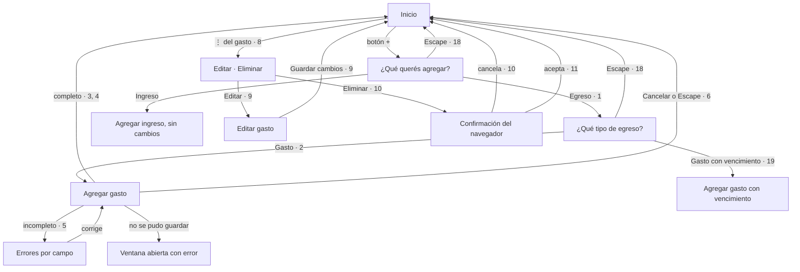

# 003 — Flujo de interacción

Spec: `specs/003-gastos-diarios/spec.md`

Lienzo: <https://claude.ai/artifact/CCVFVEiNqt285UgaxeM2za> (privado: compartilo para que otro lo valide).
Lo que vale es este archivo.

## Recorrido



## Componentes de Bootstrap

| Paso | Componente | ¿Cubre lo que pide la spec? |
|---|---|---|
| Pasos 1 y 2 | [Modal](https://getbootstrap.com/docs/5.3/components/modal/) y [list group](https://getbootstrap.com/docs/5.3/components/list-group/), ya en uso | Sí. Nivva cambia título y opciones, y agrupa las opciones con ese título para que se anuncie |
| Formularios | Modal, [campo](https://getbootstrap.com/docs/5.3/forms/form-control/) y [select](https://getbootstrap.com/docs/5.3/forms/select/) | Sí |
| Errores | [Validación](https://getbootstrap.com/docs/5.3/forms/validation/) | Solo color y texto. Nivva marca el campo y lo asocia a su mensaje |
| Fila | [Tabla](https://getbootstrap.com/docs/5.3/content/tables/) con `createListRow`, ya en uso | Sí. Sin `table-responsive`, que recorta el menú ⋮ |
| Menú ⋮ | `menu-button` de la spec 001 ([dropdown](https://getbootstrap.com/docs/5.3/components/dropdowns/)) | Sí |
| Eliminar | `confirm()` del navegador | Sí |
| Mensajes | [Toast](https://getbootstrap.com/docs/5.3/components/toasts/) | Falta la región de anuncios presente antes del toast: la suma T05 |

## Wireframe

```
Notación: [Botón]  [__] campo  [▾] desplegable  ⋮ menú  «texto» de la spec

┌──────────────────────────────────┐  320 px
│ «¿Qué tipo de egreso?»        ✕  │  Modal, bottom sheet
│ [«Gasto»                       ] │  List group, con foco
│  «Súper, transporte, salidas»    │
│ [«Gasto con vencimiento»       ] │  List group
│  «Tarjeta, préstamo, alquiler,   │
│    servicio»                     │
├──────────────────────────────────┤
│ «Agregar gasto»               ✕  │  Modal
│ «Descripción» [__]               │  Campo, con foco
│ «Ingresá una descripción.»       │  Validación, si falta
│ «Monto» [____]    «Moneda» [▾]   │  Campo y select, en fila
│ «Fecha» [__ hoy]                 │  Campo
│ «No pudimos guardar el gasto…»   │  Alert, si falla
│    [«Cancelar»] [«Agregar gasto»]│  Botones
├──────────────────────────────────┤
│ Fila                             │  Tabla, sin scroll
│ «Súper»            «$ 5.000,00» ⋮│  Descripción de hasta 2 líneas
│ «Gasto · 03/11/2026»             │  Texto, no solo color
│                     «Editar»     │  Menú abierto
│                     «Eliminar»   │
└──────────────────────────────────┘
```

## Heurísticas de Nielsen

1. Sí: mensaje visible y anunciado, y la fila y el resumen cambian sin recargar.
2. Sí: "gasto" y "gasto con vencimiento", del glosario.
3. **Hallazgo:** el segundo paso no tiene "Volver": se cierra y se empieza de nuevo. La spec no lo pide; se valida en el teléfono en T06.
4. Sí: mismas ventanas, fila y menú que el resto de Nivva.
5. Elegir el tipo equivocado: no se puede cambiar (criterio 21); los detalles de cada opción orientan.
6. Sí: el formulario trae moneda y fecha, y la fila dice el tipo.
7. Sí: tres toques hasta el formulario, con foco en Descripción y fecha de hoy.
8. Sí: el gasto no pide acreedor, vencimiento ni interruptor.
9. Sí: cada campo dice qué falta y el foco va al primero.
10. No hace falta: los detalles de cada tipo alcanzan.
