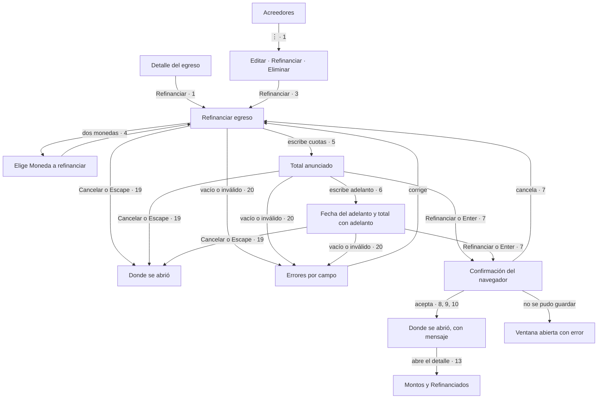

# 004 — Flujo de interacción

Spec: `specs/004-refinanciar-egreso/spec.md`

Lienzo: <https://claude.ai/artifact/RAnMUFqxaDqkXx6TEbuELC> (privado: compartilo para que otro lo valide).
Lo que vale es este archivo.

## Recorrido



Decisión de foco (criterios 10 y 19): el detalle se cierra al abrir la ventana, igual que con `Editar`. Si se abrió
desde el detalle, el foco vuelve a la fila que abrió ese detalle. Si esa fila ya no está en la lista del mes, va al
botón `+`. Desde el menú ⋮, vuelve al ⋮ de ese egreso, también después de que la lista se dibuja de nuevo.

## Componentes de Bootstrap

| Paso | Componente | ¿Cubre lo que pide la spec? |
|---|---|---|
| Menú ⋮ | [Dropdown](https://getbootstrap.com/docs/5.3/components/dropdowns/) de `AcreedoresList`, ya en uso | Sí. Nivva pone el nombre `Refinanciar Banco Galicia` |
| Botón del detalle | [Botón](https://getbootstrap.com/docs/5.3/components/buttons/) | Sí, con el mismo nombre |
| Ventana | [Modal](https://getbootstrap.com/docs/5.3/components/modal/), con `ui-modal` y `app-form` | Sí |
| Campos | [Campo](https://getbootstrap.com/docs/5.3/forms/form-control/) y [select](https://getbootstrap.com/docs/5.3/forms/select/) | Sí. Cuotas es texto, porque el teclado numérico puede no traer coma |
| Total | Texto, con una región de anuncios | Bootstrap no anuncia. Nivva agrega la región antes de que cambie el texto |
| Errores | [Validación](https://getbootstrap.com/docs/5.3/forms/validation/) | Solo color y texto. Nivva marca el campo y lo asocia a su mensaje |
| Confirmar | `confirm()` del navegador | Sí |
| Error al guardar | [Alert](https://getbootstrap.com/docs/5.3/components/alerts/) | Sí, con `role="alert"` |
| Mensaje al guardar | [Toast](https://getbootstrap.com/docs/5.3/components/toasts/) y su región de anuncios, ya en uso | Sí |
| Refinanciados | [List group](https://getbootstrap.com/docs/5.3/components/list-group/) | Sí. Cada fila se entiende sola, sin scroll horizontal |

## Wireframe

```
Notación: [Botón]  [__] campo  [▾] desplegable  ⋮ menú  «texto» de la spec

┌──────────────────────────────────┐  320 px
│ Acreedores: menú ⋮ de la fila    │  Dropdown
│                     «Editar»     │
│                     «Refinanciar»│  Solo con montos sin pagar
│                     «Eliminar»   │
├──────────────────────────────────┤
│ «Refinanciar egreso»          ✕  │  Modal
│ Banco Galicia                    │  Texto
│ «Vas a reemplazar 3 montos sin   │  Texto
│   pagar: $ 45.000,00»            │
│ «Moneda a refinanciar» [▾]       │  Select, solo con dos monedas
│ «Cuotas, separadas por coma» [__]│  Campo, foco si hay una moneda
│ «Ejemplo: 5000, 5000, 4800.50»   │  Ayuda
│ «Primer vencimiento» [__]        │  Campo
│ «Adelantar capital (opcional)»[_]│  Campo
│ «Fecha del adelanto» [__ hoy]    │  Campo, solo con adelanto
│ «3 cuotas. Total: $ 14.800,50.   │  Texto anunciado
│   Adelanto: $ 20.000,00.»        │
│ «No pudimos guardar la           │  Alert, si falla
│   refinanciación. Intentá…»      │
│     [«Cancelar»] [«Refinanciar»] │  Botones
├──────────────────────────────────┤
│ «Detalle del egreso»          ✕  │  Modal
│ «Total pendiente», datos         │  Sin cambios
│ «Montos»                         │  Tabla, sin cambios
│ «Refinanciados»                  │  Título de la lista
│ $ 15.000,00 · 10/05/2026         │  List group
│ «Refinanciado el 03/11/2026»     │  Texto, no solo color
│ [«Editar»][«Refinanciar»][«Cerrar»]  Botones; pueden pasar de línea
└──────────────────────────────────┘
```

## Heurísticas de Nielsen

1. Sí: el total se ve y se anuncia al escribir, y al guardar hay mensaje y los totales cambian sin recargar.
2. Sí: "refinanciar", "monto" y "adelanto", del glosario; "cuotas" solo para escribir el plan.
3. Sí hasta confirmar: `Cancelar`, `Escape` y cancelar la confirmación no cambian nada. Después no hay deshacer (spec).
4. Sí: mismo menú, ventana y validación que el resto de Nivva.
5. Escribir `5000,50` por `5000.50`: da dos cuotas. El total visible y la confirmación lo muestran antes de guardar.
6. Sí: el resumen dice qué se reemplaza, sin ir al detalle.
7. Sí: dos toques hasta la ventana y foco en el primer campo.
8. Sí: moneda y fecha del adelanto aparecen solo si hacen falta.
9. Sí: cada campo dice qué falta, el foco va al primero y lo escrito queda.
10. Sí: el ejemplo de cuotas siempre visible.
