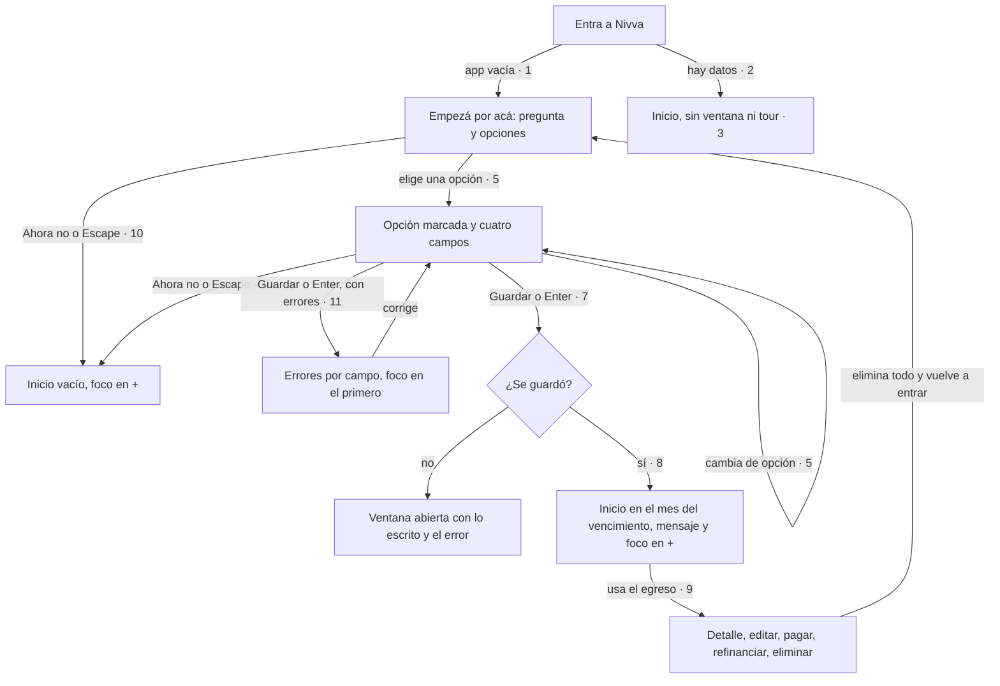

# 005 — Flujo de interacción

Spec: `specs/005-empeza-por-aca/spec.md`

Lienzo: <https://claude.ai/artifact/9Cf8hb4vi7cTwYiBpvoTza> (privado: compartilo para que otro lo valide).
Lo que vale es este archivo.

## Recorrido



Decisión de foco: al abrirse, el foco va a la pregunta, que es el nombre del grupo de opciones, y `Tab` lleva a la
primera opción (criterio 1). Al cerrar sin guardar o después de guardar, el foco va a `add-fab` (criterios 8 y 10).

## Componentes de Bootstrap

| Paso | Componente | ¿Cubre lo que pide la spec? |
|---|---|---|
| Ventana | [Modal](https://getbootstrap.com/docs/5.3/components/modal/) con `ui-modal`, `modal-fullscreen-sm-down` | Sí. `Escape` cierra igual que `Ahora no` |
| Pregunta y bajada | Título del grupo y texto | Sí |
| Seis opciones | [Radios con `btn-check`](https://getbootstrap.com/docs/5.3/forms/checks-radios/#radio-toggle-buttons) en `fieldset` | Sí. Se anuncian como radios, no como botones; flechas para moverse |
| Campos | [Campo](https://getbootstrap.com/docs/5.3/forms/form-control/) con `app-form`, ya en uso | Sí. Ayuda debajo de Acreedor |
| Moneda | [Select](https://getbootstrap.com/docs/5.3/forms/select/) con `Pesos` y `Dólares` | Sí, viene en `Pesos` |
| Errores | [Validación](https://getbootstrap.com/docs/5.3/forms/validation/) | Solo color y texto. Nivva marca el campo y lo asocia a su mensaje, como en gastos |
| Error al guardar | [Alert](https://getbootstrap.com/docs/5.3/components/alerts/) | Sí, con `role="alert"` |
| Mensaje al guardar | [Toast](https://getbootstrap.com/docs/5.3/components/toasts/) y su región de anuncios, ya en uso | Sí, no mueve el foco |

## Wireframe

```
Notación: [Botón]  [__] campo  [▾] desplegable  (●) opción elegida  «texto» de la spec

┌──────────────────────────────────┐  320 px · al entrar con la app vacía
│ «Empezá por acá»                 │  Modal, pantalla completa
│ «¿Qué te preocupa más este mes?» │  Nombre del grupo, con el foco
│ «Cargá solo eso. El resto puede  │  Texto
│   esperar.»                      │
│ [«Tarjeta de crédito»]           │  btn-check, una por línea
│ [«Préstamo»]                     │
│ [«Alquiler»]                     │
│ [«Servicio»]                     │
│ [«Familia o conocidos»]          │
│ [«Otro»]                         │
│                     [«Ahora no»] │  Botón secundario
├──────────────────────────────────┤  después de elegir «Familia o conocidos»
│ (●) «Familia o conocidos»        │  Las otras cinco siguen arriba
│ «Acreedor» [Mi hermana Carolina_]│  Campo, recibe el foco
│ «Por ejemplo: Banco Galicia, el  │  Ayuda
│   almacén, mi hermana»           │
│ «Monto» [__]                     │  Campo
│ «Moneda» [Pesos ▾]               │  Select
│ «Vencimiento» [__]               │  Campo, vacío
│ «No pudimos guardarlo. Intentá…» │  Alert, solo si falla
│        [«Ahora no»] [«Guardar»]  │  Botones
├──────────────────────────────────┤  Guardar con todo vacío
│ «Acreedor» [__]                  │  Foco acá
│ «Escribí el acreedor.»           │
│ «Monto» [__] «Ingresá un monto…» │
│ «Vencimiento» [__] «Ingresá una…»│
├──────────────────────────────────┤  Inicio después de guardar
│ ‹ diciembre de 2026 ›            │  Cambió al mes del vencimiento
│ «Deuda total acumulada»          │
│   $ 85.000,00                    │  Lo incluye
│ (MC) Mi hermana Carolina         │  Fila de hoy, sin cambios:
│   [Familia o conocidos] 10/12    │  badge del tipo y vencimiento
│   $ 85.000,00            (◯─)    │  interruptor sin pagar
│ «Listo, ya lo cargaste. Vence el │  Toast, sin mover el foco
│   10 de diciembre de 2026.»      │
│                              (+) │  Foco acá
└──────────────────────────────────┘
```

En PC (desde 576 px) la ventana no ocupa toda la pantalla y las opciones van en dos columnas de tres. Con un
vencimiento pasado (`03/10/2026`) Inicio muestra octubre y la fila marca el vencido, como hoy. Después de guardar
no se vuelve a ver la ventana: la app ya no está vacía.

## Heurísticas de Nielsen

1. Sí: la opción queda marcada, aparecen los campos, y al guardar cambia el mes, se ve la fila y se anuncia.
2. Sí: las opciones son palabras de la persona; "acreedor", "monto" y "vencimiento", del glosario.
3. Sí: `Ahora no` y `Escape` siempre; cambiar de opción no borra lo escrito.
4. Sí: misma ventana, campos y validación que gastos y refinanciar.
5. Elegir un mes que no es el actual: el mes de Inicio sigue al vencimiento para que se vea lo cargado.
6. Sí: todo está en una sola pantalla.
7. Sí: una opción, tres datos y `Guardar`.
8. Sí: los campos aparecen recién después de elegir; sin cuotas ni notas.
9. Sí: cada campo dice qué falta, el foco va al primero y lo escrito queda.
10. Sí: la ayuda de Acreedor muestra que vale una persona o el almacén.
